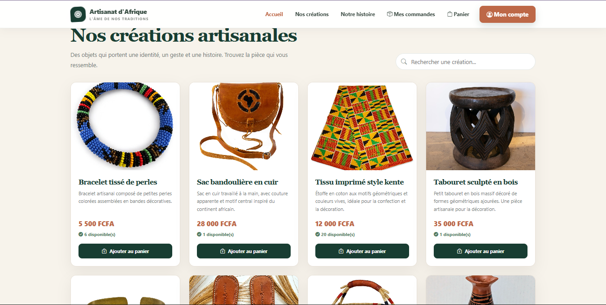
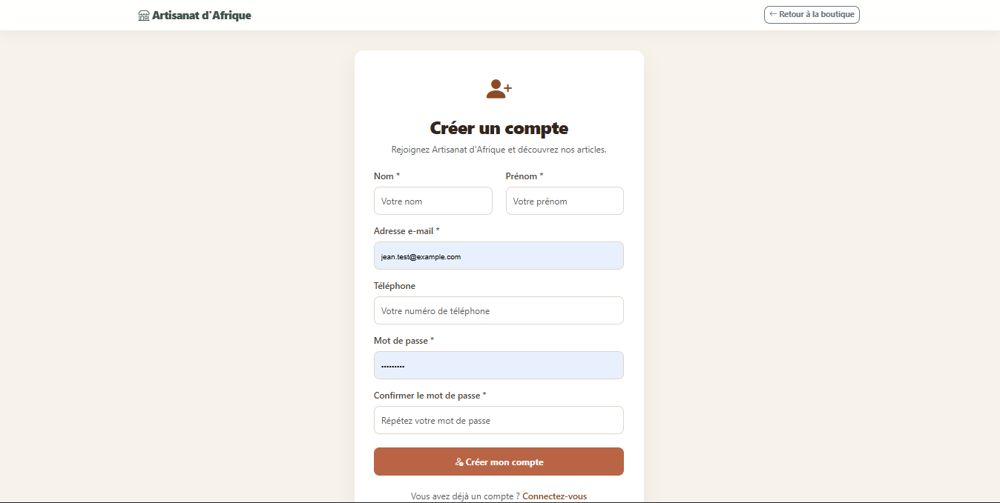
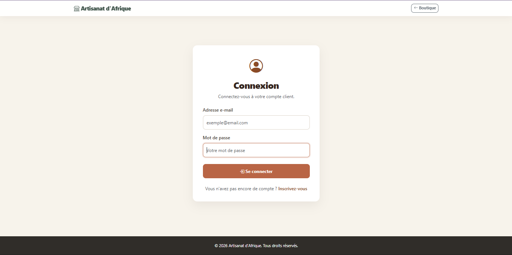
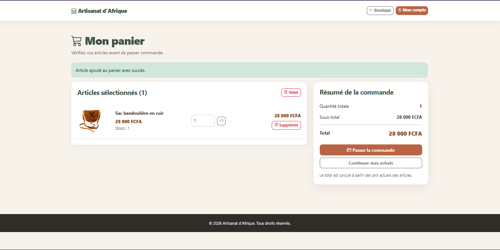
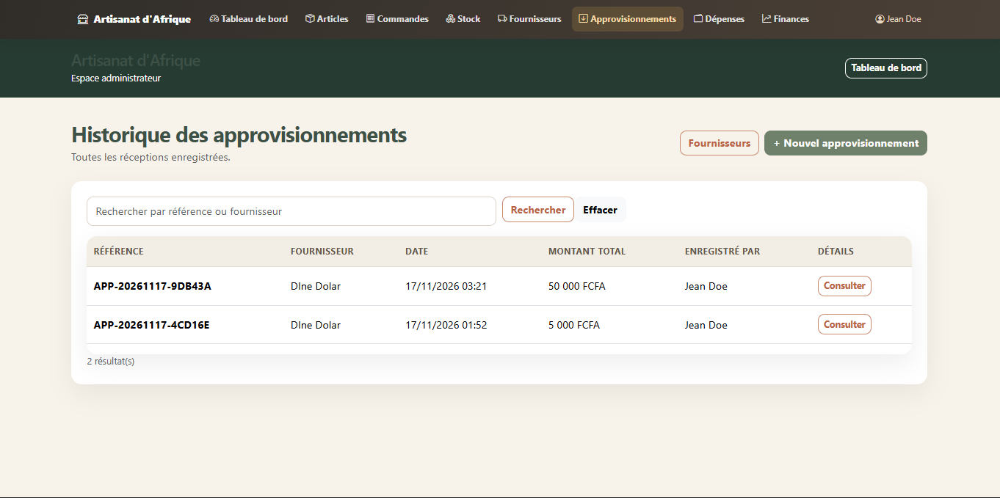

# Artisanat d’Afrique 🇧🇯

**Plateforme web de vente et de gestion d’articles artisanaux africains.**

Artisanat d’Afrique est une application web développée avec PHP et MySQL. Elle vise à faciliter la présentation et la vente d'articles artisanaux tout en proposant un espace d'administration pour gérer les activités commerciales.

## Présentation du projet

La plateforme comprend deux espaces principaux :

- **Espace client :** inscription, connexion, consultation des articles, panier et suivi des commandes.
- **Espace administrateur :** gestion des articles, commandes, stocks, fournisseurs, approvisionnements et finances.

## Fonctionnalités

### Espace client
- Création de compte et authentification.
- Consultation du catalogue d'articles.
- Gestion du panier.
- Passage et consultation des commandes.
- Gestion du compte client.

### Administration
- Tableau de bord.
- Gestion des articles et des catégories.
- Gestion des commandes.
- Suivi des stocks et historique des mouvements.
- Alertes de stock faible.
- Gestion des fournisseurs.
- Gestion des approvisionnements.
- Gestion des dépenses et des finances.
- Génération de factures PDF.

## Technologies utilisées

| Technologie | Utilisation |
|---|---|
| PHP | Développement côté serveur |
| MySQL | Gestion de la base de données |
| HTML | Structure des pages |
| CSS | Mise en forme et interface |
| JavaScript | Interactions côté client |
| Composer | Gestion des dépendances PHP |
| Dompdf | Génération de factures PDF |

## Organisation du projet

```text
artisanat-d-afrique/
│
├── backend/
│   ├── api/
│   └── config/
│
├── database/
│   └── schema.sql
│
├── web/
│   ├── admin/
│   ├── client/
│   └── assets/
│
├── ajouter_15_articles.sql
├── composer.json
├── composer.lock
├── README.md
└── .gitignore
```

## Installation locale

### Prérequis

- XAMPP ou un environnement Apache/PHP/MySQL.
- PHP 8 ou version compatible avec les dépendances.
- Composer.

### Étapes

1. Cloner le dépôt :

```bash
git clone https://github.com/rodrigueloufondei7-code/artisanat-d-afrique.git
```

2. Placer le projet dans le répertoire `htdocs` de XAMPP.

3. Créer une base de données MySQL nommée :

```text
artisanat_afrique
```

4. Importer le fichier `database/schema.sql` dans phpMyAdmin.

5. Si tu souhaites charger les 15 articles de démonstration, importer également `ajouter_15_articles.sql`.

6. Configurer les paramètres de connexion à MySQL dans :

```text
backend/config/db.php
```

7. Installer les dépendances :

```bash
composer install
```

8. Ouvrir le projet dans ton navigateur à l'adresse :

```text
http://localhost/artisanat_afrique/web/
```

Adapte l'URL si ton environnement local utilise un autre chemin.

## Base de données

La structure de la base de données est disponible dans `database/schema.sql`.

Le fichier `ajouter_15_articles.sql` permet d'ajouter des articles de démonstration.

## Sécurité

- Ne publiez jamais de mots de passe, clés secrètes ou jetons d'authentification.
- Configurez vos propres identifiants de base de données.
- N'utilisez pas de véritables données personnelles dans les démonstrations.

## Objectif du projet

Ce projet a pour objectif de mettre en pratique le développement web, la conception d'une base de données relationnelle, la programmation PHP et la création d'un système de gestion commerciale.

## Statut

Projet de portfolio — en cours d'amélioration.

---

**Artisanat d’Afrique** — Valoriser l'artisanat africain grâce au numérique.

## 📸 Captures d'écran

### 1. Page d'accueil


### 2. Catalogue des articles


### 3. Inscription client


### 4. Connexion client


### 5. Panier


### 6. Connexion administrateur


### 7. Tableau de bord


### 8. Gestion des articles


### 9. Gestion du stock


### 10. Fournisseurs


### 11. Finances


### 12. Approvisionnements

